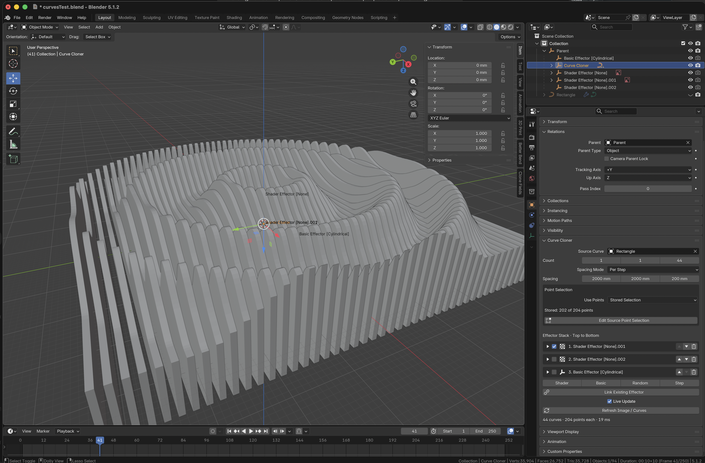

# Clone Fields

Clone and arrange objects, or deform native 2D curves with images and effectors.

- **Cloner:** fast object cloning using Geometry Nodes.
- **Curve Cloner:** independent Blender curves with normal extrusion and bevel.

## Install

1. Download [clone_fields.zip](dist/clone_fields.zip). Leave it zipped.
2. In Blender, open **Edit > Preferences > Extensions > Install from Disk…**
   and choose the ZIP.
3. Enable **Clone Fields**. Restart Blender after updating an installed version.

## Clone objects

1. Select the object you want to clone.
2. Choose **Add > Clone Fields > Cloner**.
3. Open **Properties > Modifiers > Clone Fields**. Set the distribution,
   count, and spacing.

Choose Grid, Brick, Linear, Radial, or Object distribution. Add effectors to
move, rotate, or scale the clones.

[More object-cloning options](docs/CLONER_GUIDE.md)

## Clone and deform curves

1. Select a **2D Curve**. Subdivide the parts you want to deform before cloning.
2. Choose **Add > Clone Fields > Curve Cloner**.
3. Open **Object Properties > Curve Cloner**. Set the count and spacing.
4. Add a **Shader** to the effector stack. Expand **Image / Elevation**, then
   click **Load Image / DEM** and choose a PNG or elevation TIFF.
5. Expand **Projection** and click **Fit Across Stack**. Under **Transform**,
   adjust **Position Y** to control the deformation height.
6. Select the original source curve. Use **Curve Data Properties > Geometry**
   to set **Extrude** and **Bevel**.

Curve Cloner keeps the curve flat in its local XY plane. The default projection
fits XY profiles stacked along Z; move or rotate the Shader Effector to change
where the image is sampled.

### Deform only selected points

1. Select the Curve Cloner and press **N** in the viewport. Open **Clone Fields**.
2. Click **Edit Source Point Selection**, then select the source points to deform.
3. Click **Store Selection & Return to Cloner**.

The stored selection limits point effects. Use **Point Selection > Use Points >
All** to affect the entire curve. Store the selection again after subdividing
or changing the point order.

### Use effectors

- **Shader** defaults to **Points** for curve deformation.
- **Basic**, **Random**, and **Step** default to **Objects** for whole-clone transforms.
- Change **Affect** to switch between Points and Objects.
- The stack runs **top to bottom**. Use the arrows to reorder it.
- Stack multiple Shaders to combine textures.
- The trash button removes an entry while keeping its Effector object.

Put Basic **above** Shader to move a clone before texture sampling. Put Basic
**below** Shader to move the already-deformed result.

Each effector has collapsible controls. **Strength Here** changes only this
entry. **Shared Strength**, under **Shared Effector Settings**, changes every
cloner using that Effector. The two multiply: 50% × 50% = 25%.

### Spacing, previews, and live updates

- **Per Step:** distance between neighboring clones.
- **Endpoint:** total distance from the first clone to the last.
- **Show Image in Viewport:** hide or show the projected image.
- **Live Update:** update automatically as settings change.
- **Refresh Image / Curves:** update manually or refresh changed image pixels.

Live curve generation pauses while the source is in Edit Mode. Store your
selection and return to the cloner, or leave Edit Mode, to resume.

### Rotate the whole group

Add an **Empty**. Select the source curve, Curve Cloner, and its effectors;
select the Empty last. Press **Ctrl+P > Object (Keep Transform)**.

Rotate the Empty to rotate the group. Generated curves already follow the
controller. New effectors join the controller's parent automatically.

[Detailed Curve Cloner guide](docs/CURVE_CLONER.md)

## Development

[Build instructions, architecture, and tests](docs/DEVELOPMENT.md)
